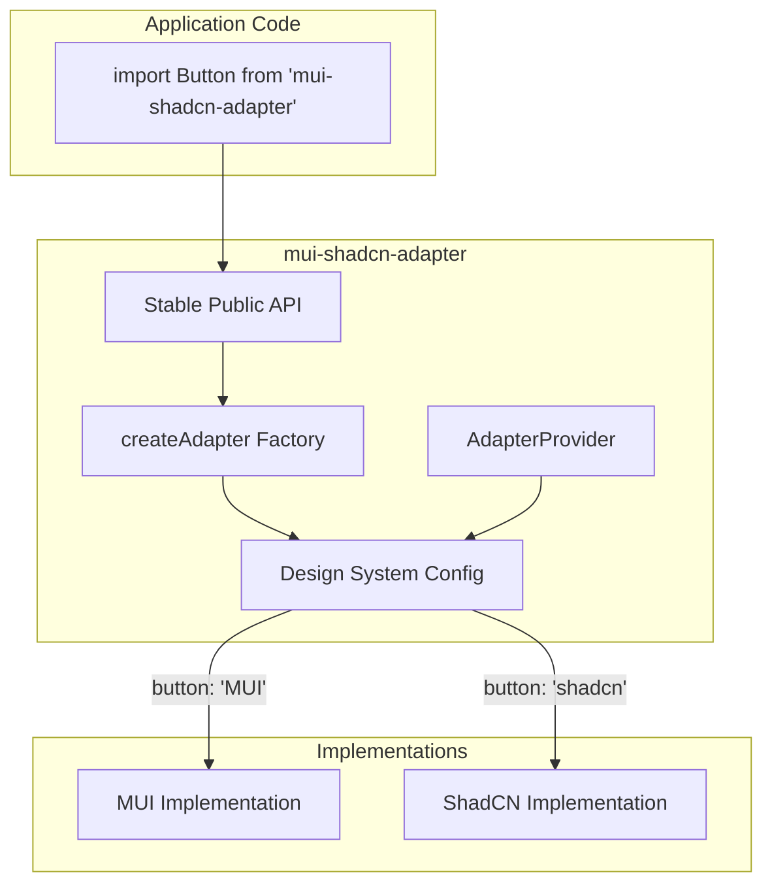

# ShadCN-MUI Adapter Migration Layer

Implementation plan for a migration layer library that allows gradual migration from MUI (MUI/styled-components) to ShadCN (Tailwind@/components/ui) design systems. The adapter exposes the **MUI component API as the public surface**, switching between implementations via per-component feature flags. No consumer code changes required—applications keep using MUI props (icon, iconPlacement, type, size, etc.).

---

## Architecture Overview



---

## 1. Folder Structure

```
libs/mui-shadcn-adapter/
├── src/
│   ├── provider/           # React context for config + future feature flag integration
│   │   └── adapter-provider.tsx
│   ├── config/             # Design system config types + default config
│   │   └── design-system-config.ts
│   ├── adapter/            # Generic createAdapter factory
│   │   ├── create-adapter.ts
│   │   └── types.ts
│   ├── components/         # Per-component adapters (MUI/ShadCN imported from their own packages)
│   │   ├── button/
│   │   │   ├── button.types.ts
│   │   │   └── button.tsx
│   │   ├── input/
│   │   ├── badge/
│   │   ├── ... (all 29 ShadCN components)
│   │   └── index.ts
│   └── telemetry/          # Optional migration logging
│       └── migration-telemetry.ts
├── index.ts
├── package.json
├── project.json
├── tsconfig.json
├── tsconfig.lib.json
└── vite.config.ts
```

**Folder purposes:**

| Folder        | Purpose                                                                                                                        |
| ------------- | ------------------------------------------------------------------------------------------------------------------------------ |
| `provider/`   | `AdapterProvider` wraps the app; supplies config via `useDesignSystemConfig()`. Future: can inject Unleash flags.              |
| `config/`     | `DesignSystemConfig` type, default config, and helper to merge with feature flag overrides.                                    |
| `adapter/`    | `createAdapter<Props>()` factory; enforces both implementations satisfy same props; selects implementation.                    |
| `components/` | One folder per adapter component; each has `.types.ts`, `.tsx` (adapter), `.MUI.tsx`, `.shadcn.tsx`. Public props = MUI props. |
| `telemetry/`  | Optional `logMUIUsage(componentName)` for migration tracking.                                                                 |

---

## 2. Design System Config

**File:** `libs/mui-shadcn-adapter/src/config/design-system-config.ts`

```typescript
export type DesignSystemVariant = 'MUI' | 'shadcn';

export type DesignSystemConfig = {
  button: DesignSystemVariant;
  input: DesignSystemVariant;
  badge: DesignSystemVariant;
  avatar: DesignSystemVariant;
  loader: DesignSystemVariant;
  skeleton: DesignSystemVariant;
  tooltip: DesignSystemVariant;
  select: DesignSystemVariant;
  label: DesignSystemVariant;
  separator: DesignSystemVariant;
  dropdownMenu: DesignSystemVariant;
  alert: DesignSystemVariant;
  dialog: DesignSystemVariant;
  inputGroup: DesignSystemVariant;
  textarea: DesignSystemVariant;
  helperText: DesignSystemVariant;
  collapsible: DesignSystemVariant;
  hoverCard: DesignSystemVariant;
  popover: DesignSystemVariant;
  command: DesignSystemVariant;
  buttonGroup: DesignSystemVariant;
  codeBlock: DesignSystemVariant;
  shimmer: DesignSystemVariant;
  // ... remaining components
};

export const defaultDesignSystemConfig: DesignSystemConfig = {
  button: 'MUI',
  input: 'MUI',
  badge: 'MUI',
  // ... all default to 'MUI' for gradual migration
};

export type DesignSystemConfigOverride = Partial<DesignSystemConfig>;
```

**Future integration:** `AdapterProvider` can accept `configOverrides` from `useFlag('shadcn-button')` etc. to merge with defaults.

---

## 3. Adapter Factory

**File:** `libs/mui-shadcn-adapter/src/adapter/create-adapter.ts`

```typescript
import { type ComponentType } from 'react';
import type { DesignSystemConfig } from '../config/design-system-config';
import { useDesignSystemConfig } from '../provider/adapter-provider';
import { logMUIUsage } from '../telemetry/migration-telemetry';

type ConfigKey = keyof DesignSystemConfig;

export function createAdapter<
  Props extends object,
  Key extends ConfigKey
>(
  configKey: Key,
  implementations: {
    MUI: ComponentType<Props>;
    shadcn: ComponentType<Props>;
  }
): ComponentType<Props> {
  const Adapter = (props: Props) => {
    const config = useDesignSystemConfig();
    const variant = config[configKey] ?? 'MUI';
    const Impl = variant === 'shadcn' ? implementations.shadcn : implementations.MUI;

    if (variant === 'MUI') {
      logMUIUsage(configKey);
    }

    return <Impl {...props} />;
  };
  Adapter.displayName = `Adapter(${configKey})`;
  return Adapter;
}
```

**Type safety:** Both `implementations.MUI` and `implementations.shadcn` must accept `Props`. TypeScript will error if either has incompatible props.

---

## 4. Public API = MUI API (No Consumer Changes)

The adapter's public props are **identical to MUI**. Applications can switch from `@mui/material` to `mui-shadcn-adapter` with only an import change—no prop changes.

- **MUI implementation:** Pass-through; forwards props directly to MUI.
- **ShadCN implementation:** Maps MUI props to ShadCN's API internally (e.g. `icon` + `iconPlacement` → render icon as prefix/suffix in children).

---

## 5. Example Component: Button

**File:** `libs/mui-shadcn-adapter/src/components/button/button.types.ts`

```typescript
// Public API = MUI Button props (no consumer changes)
import type { ComponentProps } from 'react';
import type { Button as MUIButton } from '@mui/material';

export type ButtonProps = ComponentProps<typeof MUIButton>;
// Or: manually define to match MUI: icon, iconPlacement, type, size, loading, children, etc.
```

**File:** `libs/mui-shadcn-adapter/src/components/button/button.tsx`

```typescript
import type { FC } from 'react';
import { Button as MUIButton } from '@mui/material';
import { Button as ShadCNButton, Loader } from '@/components/ui';
import { createAdapter } from '../../adapter/create-adapter';
import type { ButtonProps } from './button.types';

const MUIImpl: FC<ButtonProps> = (props) => <MUIButton {...props} />;

const ShadCNImpl: FC<ButtonProps> = ({
  icon,
  iconPlacement = 'left',
  children,
  loading,
  type,
  size,
  ...props
}) => {
  const shadcnVariant = mapMUITypeToShadCN(type);
  const shadcnSize = mapMUISizeToShadCN(size);
  const content = loading ? (
    <Loader />
  ) : (
    <>
      {iconPlacement === 'left' && icon}
      {children}
      {iconPlacement === 'right' && icon}
    </>
  );

  return (
    <ShadCNButton variant={shadcnVariant} size={shadcnSize} disabled={loading} {...props}>
      {content}
    </ShadCNButton>
  );
};

export const Button = createAdapter<ButtonProps, 'button'>('button', {
  MUI: MUIImpl,
  shadcn: ShadCNImpl,
});
```

---

## 6. Type Safety

- Use `ButtonMUI satisfies ComponentType<ButtonProps>` and `ButtonShadCN satisfies ComponentType<ButtonProps>` in tests or strict checks.
- **Adapter factory:** `createAdapter<Props, Key>` ensures both implementations receive `Props`.
- **Props drift:** If MUI or ShadCN gains a required prop that the other lacks, TypeScript will error at the `createAdapter` call site.

---

## 7. Migration Telemetry

**File:** `libs/mui-shadcn-adapter/src/telemetry/migration-telemetry.ts`

```typescript
let isTelemetryEnabled = false;

export function enableMigrationTelemetry() {
  isTelemetryEnabled = true;
}

export function logMUIUsage(componentName: string) {
  if (isTelemetryEnabled && typeof window !== 'undefined') {
    console.debug(`[mui-shadcn-adapter] MUI render: ${componentName}`);
    // Future: send to analytics
  }
}
```

---

## 8. Developer Usage

**Migration:** Change only the import; keep all existing props.

```diff
- import { Button } from '@mui/material';
+ import { Button } from 'mui-shadcn-adapter';
```

```typescript
// App root
import { AdapterProvider } from 'mui-shadcn-adapter';

<AdapterProvider config={{ button: 'shadcn', input: 'MUI' }}>
  <App />
</AdapterProvider>

// Component - identical API to MUI; no prop changes
import { Button } from 'mui-shadcn-adapter';

<Button type="primary" icon={<PlusIcon />} iconPlacement="left">
  Create
</Button>
```

---

## 9. Future Migration Path

1. **Simultaneous:** Both MUI and ShadCN implementations exist; config switches per component.
2. **Gradual:** Flip `button: 'shadcn'` in config; all `<Button>` usages render ShadCN.
3. **Removal:** Once all components use `'shadcn'`, delete `.MUI.tsx` files and MUI dependency; simplify adapter to re-export ShadCN directly.

---

## 10. Adapters for All ShadCN Components

Generate adapters for all 29 ShadCN component groups. **Files** = number of files in `apps/` that import the MUI equivalent from `@mui/material`.

| Priority | ShadCN Component | MUI Equivalent | Files    |
| -------- | -------------- | --------------- | -------- |
| P0       | Button         | Button          | 581      |
| P0       | Input          | Input           | 162      |
| P0       | Dialog         | Modal           | 174      |
| P0       | Tooltip        | Tooltip         | 184      |
| P0       | DropdownMenu   | Menu            | 154      |
| P1       | Loader         | Loader          | 111      |
| P1       | Select         | Select          | 93       |
| P1       | Skeleton       | Skeleton        | 50       |
| P1       | Separator      | Divider         | 52       |
| P1       | Badge          | TagChip         | 46       |
| P1       | Checkbox       | Checkbox        | 43       |
| P1       | Alert          | Infobox         | 73       |
| P2       | Textarea       | Textarea        | 23       |
| P2       | Label          | TextLabel       | 19       |
| P2       | Avatar         | Avatar          | 17       |
| P2       | Collapsible    | Accordion       | 16       |
| P2       | Dropdown       | Dropdown        | 49       |
| P2       | EmptyState     | EmptyState      | 35       |
| P2       | HoverCard      | Tooltip         | (shared) |
| P2       | Popover        | Popover         | 3        |
| P3       | ButtonGroup    | (Flex/composed) | 0        |
| P3       | InputGroup     | (composed)      | 0        |
| P3       | HelperText     | (Body/custom)   | 0        |
| P3       | Command        | -               | 0        |
| P3       | Shimmer        | -               | 0        |
| P3       | CodeBlock      | -               | 0        |
| -        | Message        | Infobox         | (shared) |
| -        | PromptInput    | -               | 0        |
| -        | Tool           | -               | 0        |
| -        | InlineCitation | -               | 0        |
| -        | Reasoning      | -               | 0        |
| -        | Sources        | -               | 0        |

**Note:** Counts are based on `grep -rE "import \{[^}]*\\bComponent\\b[^}]*\} from ['\"]@mui/material" apps --include="*.tsx" --include="*.ts" -l | wc -l`. For `DropdownMenu`, MUI commonly uses both `Menu` (154 files) and `Dropdown` (49 files); the higher count (`Menu`) is shown. `HoverCard` and `Message` conceptually reuse `Tooltip` and `Infobox` usage respectively.

**Compound components** (Dialog, DropdownMenu, Command): Adapter wraps the root; sub-components pass through or have their own adapters where MUI has equivalents.

**ShadCN-only components** (PromptInput, InlineCitation, Reasoning, Message, Tool, Sources, Shimmer, CodeBlock, Tool): No direct MUI equivalent; adapter can re-export ShadCN directly or omit initially.

---

## Implementation Order

1. **Scaffold:** Create `libs/mui-shadcn-adapter` with `package.json`, `project.json`, `tsconfig.json`, `vite.config.ts`.
2. **Core:** Implement `config/`, `provider/`, `adapter/`, `telemetry/`.
3. **Button:** Full button example (types, MUI, shadcn, adapter).
4. **Input:** Input adapter with same pattern.
5. **Badge, Avatar, Loader, Skeleton:** Simple adapters.
6. **Dialog, Tooltip, Select, Label, Separator, HelperText:** Medium complexity.
7. **Remaining components:** DropdownMenu, Alert, InputGroup, Textarea, Collapsible, HoverCard, Popover, Command, ButtonGroup, CodeBlock, Shimmer.
8. **ShadCN-only components:** Re-export from ShadCN or omit from adapter initially.

---

## Dependencies

- `@mui/material` (alias to `@mui/material.js@11.0.1`) – MUI
- `@/components/ui` – ShadCN
- `react` – peer
- Optional: `feature-flag-client` for future Unleash integration

---

## Package Export

```json
{
  "name": "mui-shadcn-adapter",
  "exports": {
    ".": {
      "source": "./src/index.ts",
      "import": "./dist/index.js",
      "types": "./dist/index.d.ts"
    }
  }
}
```
