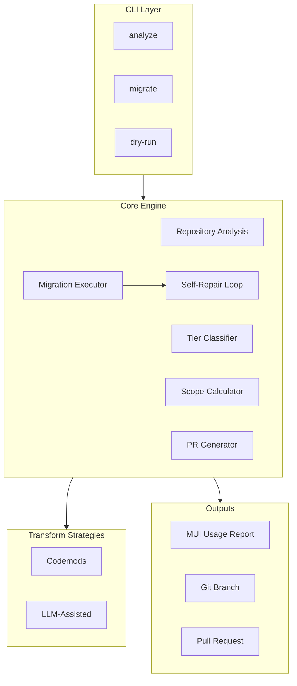

# Agentic MUI-to-ShadCN Migration Tool: Implementation Plan

## 1. Architecture Overview



**Tool location:** Create a new package `tools/migrate-mui-shadcn` (or `libs/migrate-mui-shadcn`) as a standalone CLI tool within the monorepo.

---

## 2. Repository Analysis Strategy

### 2.1 Dependency Graph Generation

**Primary source: Nx project graph**

- Use `nx graph --file=graph.json` or the Nx programmatic API (`createProjectGraphAsync`) to obtain the full dependency graph.
- Fallback: Parse `package.json` workspace deps + `tsconfig.base.json` path mappings (as [scripts/scan-MUI-usage.js](../scripts/scan-MUI-usage.js) does via `getWorkspaceDeps` and `getTransitiveLibDeps`).
- Output: Directed graph of `(projectName, dependencies[])` for apps and libs.

**Implementation approach:**

- Add `@nx/workspace` (or use `nx` CLI) as a dev dependency in the migration tool.
- Call `createProjectGraphAsync()` from `@nx/devkit` to get `ProjectGraph` with `nodes` and `dependencies`.
- Map project names to filesystem paths via `project.json` / `package.json` locations.

### 2.2 MUI Usage Detection

**Extend [scripts/scan-MUI-usage.js](../scripts/scan-MUI-usage.js) into a reusable analysis module.**

Current approach (regex-based):

```javascript
/import\s*\{([^}]+)\}\s*from\s*['"](@mui\/material|@mui\/lab|@mui\/system)['"]/g;
```

**Upgrade path for the migration tool:**

| Tool                | Purpose                                           | When to Use                                                 |
| ------------------- | ------------------------------------------------- | ----------------------------------------------------------- |
| **Regex (current)** | Fast, good for import extraction                  | Initial scan, dry-run counts                                |
| **ts-morph**        | Full AST, accurate JSX detection, safe transforms | Codemod execution, precise replacements                     |
| **jscodeshift**     | Codemod ecosystem, transform API                  | Alternative to ts-morph for jscodeshift-compatible codemods |

**Recommendation:** Use **ts-morph** as the primary AST tool because:

- TypeScript-native, preserves types and formatting
- Single API for both analysis and transformation
- No Babel/Recast pipeline; direct TS/JSX manipulation
- Add `ts-morph` as a dependency (not currently in the repo; jscodeshift exists only transitively)

**MUI usage report schema:**

```typescript
interface MUIUsageReport {
  byProject: Map<string, ProjectMUIUsage>;
  byComponent: Map<string, ComponentUsage>;
}

interface ProjectMUIUsage {
  projectName: string;
  path: string;
  components: Map<string, number>; // Button: 64, Tooltip: 14, ...
  files: string[];
  totalLoc: number;
  supported: string[]; // ShadCN-supported components
  stillOnMUI: string[]; // Deferred components
}
```

**Data sources:**

- Reuse `SHADCN_SUPPORTED` and `STILL_ON_MUI` sets from [scripts/scan-MUI-usage.js](../scripts/scan-MUI-usage.js) (lines 17–30).
- Walk `src/`, `modules/src/`, `components/src/` per project (as in `getSourceDirs`).
- For each `.ts`, `.tsx`, `.js`, `.jsx` file: extract imports via regex or ts-morph; count JSX usages per component via AST.

---

## 3. Library Tier Classification Algorithm

### 3.1 Inputs

- **Dependency graph:** From Nx (or package.json fallback).
- **App → Libs:** For each app, the set of libs it depends on (transitively).
- **Lib → Apps:** For each lib, the count of apps that depend on it (directly or transitively).

### 3.2 Classification Rules

| Tier                   | Condition                    | Examples                                      |
| ---------------------- | ---------------------------- | --------------------------------------------- |
| **Tier 1 (Global)**    | Used by ≥ N apps (e.g. N=20) | `shared-ui-components`, `shared-data-utils`   |
| **Tier 2 (Feature)**   | Used by 2–(N-1) apps         | `feature-components`, `domain-widgets`        |
| **Tier 3 (App-local)** | Used by exactly 1 app        | `app-local-ui`, `single-app-components`       |

**Threshold:** Use configurable `GLOBAL_TIER_THRESHOLD` (default 20). Libs used by ≥20 apps → Tier 1.

**Implementation:**

```typescript
function classifyLibrary(libName: string, appCount: number, hasMUIUsage: boolean): 'tier1' | 'tier2' | 'tier3' {
  if (!hasMUIUsage) return 'tier3'; // No migration needed
  if (appCount >= GLOBAL_TIER_THRESHOLD) return 'tier1';
  if (appCount >= 2) return 'tier2';
  return 'tier3';
}
```

**Output:** `Map<libName, Tier>` plus a report listing libs per tier.

---

## 4. Migration Scope Calculation

### 4.1 When Migrating App X

**In scope:**

- The app `apps/X` itself.
- All **Tier 2** and **Tier 3** libs that the app depends on (transitively).

**Excluded:**

- **Tier 1** libs. These remain behind the UI driver (see Section 7).

### 4.2 Algorithm

```text
scope = { app }
for each lib in transitiveDeps(app):
  if tier(lib) in ['tier2', 'tier3']:
    scope.add(lib)
  else:
    # tier1: do not migrate; lib uses UI driver
    exclude(lib)
return scope
```

**Output:** Ordered list of projects to migrate (topological order: libs first, then app).

---

## 5. UI Driver Architecture for Global Libraries

### 5.1 Design (Different from mui-shadcn-adapter)

The [mui-shadcn-adapter-plan.md](mui-shadcn-adapter-plan.md) describes a **per-component feature-flag adapter**. The migration tool requires a **UI driver** pattern instead:

- **Tier 1 libs** do not import MUI or ShadCN directly.
- They obtain UI primitives via a React context: `useUIContext()` → `Button`, `Modal`, etc.
- The **app** provides the driver: `<UIDriverProvider value={shadcnDriver}>` or `value={MUIDriver}`.
- Each app uses exactly one driver (no mixing).

### 5.2 UI Driver Interface

```typescript
// libs/ui-driver/src/types.ts
interface UIDriver {
  Button: ComponentType<ButtonProps>;
  Tooltip: ComponentType<TooltipProps>;
  Modal: ComponentType<ModalProps>;
  Input: ComponentType<InputProps>;
  // ... all components used by Tier 1 libs
}
```

### 5.3 Implementation Steps (Pre-migration)

1. **Create `libs/ui-driver`** – defines the interface and `UIContext`.
2. **Create `libs/ui-driver-MUI`** – implements `UIDriver` with MUI components.
3. **Create `libs/ui-driver-shadcn`** – implements `UIDriver` with ShadCN components (prop mapping as in v2 doc).
4. **Refactor Tier 1 libs** – replace `import { Button } from '@mui/material'` with `const { Button } = useUIContext()`.
5. **App bootstrap** – each app wraps itself with `<UIDriverProvider value={MUIDriver | shadcnDriver}>`.

**Migration tool responsibility:** The tool does **not** implement the UI driver. It **identifies** Tier 1 libs and **reports** that they must be refactored to use the driver before app migrations. The actual driver refactor is a separate, manual or semi-automated effort.

**Tool output:** When computing scope, the tool outputs:

- "Tier 1 libs (excluded from this migration): X, Y, Z. These must use the UI driver."
- "Migration scope: app A, libs L1, L2."

---

## 6. Codemod Implementation Strategy

### 6.1 Shadcn-Based ShadCN: Structural Changes Are the Norm

ShadCN is built on shadcn/ui patterns, which use **composition (children)** rather than props for many behaviors. As a result, **even components that appear "simple" involve structural changes**—not just prop renames.

**Example: Button** (from v2 doc)

MUI uses props for icon, loading, and toggled state:

```tsx
<Button type="primary" icon={<AddIcon />} iconPlacement="left" loading={isLoading} toggled={isActive}>
  Create
</Button>
```

ShadCN@/components/ui expects composition:

```tsx
<Button variant="default" disabled={isLoading} className={isActive ? 'bg-accent' : undefined}>
  {isLoading ? (
    <Loader size={16} />
  ) : (
    <>
      {iconPlacement === 'left' && <IconPlus />} Create {iconPlacement === 'right' && <IconPlus />}
    </>
  )}
</Button>
```

**Structural changes for Button alone:**

- `icon` prop → inline icon as child (with `iconPlacement` logic)
- `loading` prop → conditional `<Loader>` in children
- `toggled` → `className` for active state
- MUI icons (`AddIcon`) → `lucide-react` equivalents (`IconPlus`)

Similar patterns apply across components: **prop-based APIs → composition-based APIs**.

### 6.2 Complexity Spectrum (Not "Simple vs Structural")

Categorize components by **transform complexity**, not by "codemod vs LLM":

| Complexity    | Components                                                         | Transform Type                                                                            |
| ------------- | ------------------------------------------------------------------ | ----------------------------------------------------------------------------------------- |
| **Low**       | Divider → Separator, Loader                                        | Near-direct replacement; import + prop rename only.                                       |
| **Medium**    | Button, Input, Skeleton, Textarea, Switch, Checkbox                | Props → children, prop renames, icon mapping. Codemod _possible_ with detailed AST logic. |
| **High**      | Avatar, Badge (TagChip/CounterChip), Select, Infobox               | Compound components (AvatarImage + AvatarFallback), or significant API differences.       |
| **Very high** | Tooltip, Modal, Dropdown, SelectPanel, Accordion, SegmentedControl | Wrapper → compound pattern; options array → children; multiple subcomponents.             |

**Implication:** Even "medium" components require non-trivial codemods. The codemod must:

1. Parse the full JSX tree (including children).
2. Extract `icon`, `loading`, `iconPlacement`, etc. from props.
3. Rebuild children with the new structure.
4. Handle icon imports (MUI → lucide-react) via a mapping table.

**Codemod vs LLM:** Use codemods where the transform is **fully specifiable** (e.g. Button with known prop set). Use LLM where the usage is **highly variable** or context-dependent (e.g. Modal with custom footer layout, Tooltip with conditional content).

**LLM-first alternative:** For faster implementation, consider an LLM-first approach: one extraction → prompt → validation → replace pipeline handles all components. Add codemods later only for high-volume components (Button, Flex) if cost becomes an issue. See cost analysis below.

### 6.3 Compound-Pattern Migrations (Codemod + LLM)

These require API/structural changes that are hard to fully codemod:

| MUI                 | ShadCN                                                              | Complexity               |
| -------------------- | ----------------------------------------------------------------- | ------------------------ |
| Tooltip              | Tooltip + TooltipTrigger + TooltipContent + TooltipProvider       | Compound pattern         |
| Modal                | Dialog + DialogContent + DialogHeader + DialogFooter              | Compound pattern         |
| Dropdown / Menu      | DropdownMenu + Trigger + Content + Item                           | Compound pattern         |
| Select + SelectPanel | Select + SelectTrigger + SelectValue + SelectContent + SelectItem | Compound pattern         |
| Infobox              | Alert + AlertTitle + AlertDescription + AlertClose                | Compound pattern         |
| Accordion            | Collapsible + Trigger + Content                                   | Compound pattern         |
| SegmentedControl     | SegmentedControl with Item children                               | Options array → children |

**Strategy:** Codemod handles import changes where possible; **LLM** rewrites the JSX block for compound patterns. For medium/high components, prefer codemods when the transform is fully specifiable; fall back to LLM for edge cases.

---

## 7. LLM Integration Workflow

### 7.1 When to Invoke LLM

- Component is in the "very high" complexity list (Tooltip, Modal, Dropdown, Select, Infobox, Accordion, SegmentedControl)—compound patterns that are hard to codemod.
- Codemod cannot fully transform (e.g. complex children, conditional rendering, edge cases in Button/Input/etc.).

### 7.2 Workflow

1. **Extract:** Use ts-morph to find the JSX block (e.g. `<Tooltip ...>...</Tooltip>`).
2. **Serialize:** Get the full JSX subtree as text (with surrounding context: 5 lines before/after).
3. **Prompt:** Send to LLM with:
   - Before snippet (MUI)
   - Target ShadCN pattern (from v2 doc)
   - Instructions: "Convert this MUI usage to ShadCN. Preserve behavior. Output only the replacement code."
4. **Validate:** Parse LLM output as TS/JSX; ensure it compiles.
5. **Replace:** Use ts-morph to replace the original JSX with the LLM output.
6. **Fallback:** If LLM output is invalid, mark for manual review and skip.

### 7.3 Safety

- Run in **dry-run** first: report "LLM rewrites: N" without applying.
- Limit context size (e.g. 2K tokens) to avoid hallucination.
- Use a deterministic codemod when possible; LLM only for ambiguous cases.
- Log all LLM inputs/outputs for audit.

---

## 8. Layout Migration (Flex → Tailwind)

### 8.1 Mapping Table

From v2 doc:

| MUI Flex Prop                   | Tailwind Class    |
| -------------------------------- | ----------------- |
| `gap={4}`                        | `gap-1`           |
| `gap={8}`                        | `gap-2`           |
| `gap={16}`                       | `gap-4`           |
| `alignItems="center"`            | `items-center`    |
| `justifyContent="space-between"` | `justify-between` |
| `direction="column"`             | `flex-col`        |
| `flex={1}`                       | `flex-1`          |

### 8.2 Codemod Strategy

1. Detect `<Flex` from MUI.
2. Extract props: `gap`, `alignItems`, `justifyContent`, `direction`, `flex`.
3. Build `className`: `flex ${directionMap[direction]} ${gapMap[gap]} ${alignMap[alignItems]} ...`.
4. Replace with `<div className={...}>` and move children.

**Edge cases:** `Flex` with `flex={1}` or custom styles → may need to preserve `style` or merge with `className`.

---

## 9. TypeScript Self-Repair Loop

### 9.1 Flow

```text
1. Run codemods + LLM transforms on scope
2. pnpm exec nx run-many -t typecheck -p <scope>
3. If errors:
   a. Parse error output (file, line, message)
   b. Extract relevant code snippet (function/block)
   c. Send to LLM: "Fix this TypeScript error: <error>. Code: <snippet>"
   d. Apply fix
   e. Goto 2 (max 3 iterations)
4. Run lint, then tests (same loop if needed)
5. If still failing after max iterations: report and exit
```

### 9.2 Implementation

- Use `nx run-many -t typecheck -p <projects> --skip-nx-cache` to get fresh errors.
- Parse stderr for file paths and line numbers (TypeScript error format).
- Use ts-morph to locate the node at that position and extract surrounding code.
- LLM prompt: include error message, code, and "Output only the fixed code."

---

## 10. Safe PR Workflow

### 10.1 Branch and Commits

```bash
git checkout -b migrate/<app-name>-shadcn
# Apply migrations to scope
git add -A
git commit -m "feat(ui): migrate <app-name> from MUI to ShadCN"
```

### 10.2 PR Description Template

```markdown
## Migration: <app-name> to ShadCN

### Scope

- **App:** apps/<app-name>
- **Libs:** libs/..., libs/...

### Component Summary

| Component | Codemod | LLM | Manual |
| --------- | ------- | --- | ------ |
| Button    | 64      | 0   | 0      |
| Tooltip   | 12      | 2   | 0      |

...

### Excluded (Tier 1)

- libs/ui-core (uses UI driver)

### Verification

- [ ] typecheck passed
- [ ] lint passed
- [ ] tests passed
```

### 10.3 Tool Responsibilities

- Create branch.
- Run migrations.
- Run self-repair loop.
- Generate PR description from report.
- Optionally: `gh pr create` if GitHub CLI is available (or output instructions).

---

## 11. Dry Run Mode

### 11.1 Command

```bash
migrate-MUI analyze apps/data-exploration
# or
migrate-MUI analyze apps/data-exploration --dry-run
```

### 11.2 Output

```text
Migration scope for apps/data-exploration:
  - apps/data-exploration
  - libs/chart-ui
  - libs/table-ui
  - libs/data-utils

Excluded (Tier 1): libs/ui-core, libs/layout

Files affected: 142
Codemod changes: 310
  - Button: 64
  - Input: 45
  - Flex→Tailwind: 92
  ...
LLM rewrites: 18
  - Tooltip: 6
  - Modal: 4
  - Select: 8
Manual components: 2
  - DataGrid (deferred)
  - makeToast (deferred)

No code changes made (dry run).
```

**Implementation:** Run analysis and scope calculation; run codemods in a "simulation" mode (count changes without writing). For LLM, optionally skip invocation and estimate from component counts.

---

## 12. CLI Design

### 12.1 Commands

| Command                                | Description                                                                 |
| -------------------------------------- | --------------------------------------------------------------------------- |
| `migrate-MUI analyze [project]`       | Full analysis; MUI report + tier classification. Optional `--json` output. |
| `migrate-MUI scope <app>`             | Compute migration scope for app.                                            |
| `migrate-MUI migrate <app>`           | Execute migration (codemods + LLM + self-repair).                           |
| `migrate-MUI migrate <app> --dry-run` | Dry run; no writes.                                                         |
| `migrate-MUI pr <app>`                | Create branch, migrate, generate PR (or PR description).                    |

### 12.2 Configuration

Config file: `migrate-MUI.config.json` (optional, in repo root or tool package):

```json
{
  "globalTierThreshold": 20,
  "llmProvider": "openai",
  "llmModel": "gpt-4",
  "maxRepairIterations": 3,
  "skipLlm": false
}
```

---

## 13. Implementation Phases

### Phase 1: Analysis (2–3 weeks, or 3–5 days with AI)

- Nx dependency graph integration.
- MUI usage scanner (ts-morph upgrade of scan-MUI-usage.js).
- Tier classification.
- Scope calculation.
- CLI: `analyze`, `scope`.

### Phase 2: Transforms (3–4 weeks codemods, or 3–5 days LLM-first)

**Codemod path:**

- ts-morph setup.
- Codemods for: Divider, Loader (low); Button, Input, Skeleton, Textarea, Switch, Checkbox (medium—each requires props→children and icon mapping logic); Avatar, Badge (high).
- Flex → Tailwind codemod.
- Icon mapping table: MUI icons → `lucide-react` equivalents.
- CLI: `migrate --dry-run` (codemods only).

**LLM-first path (faster to implement):**

- One extraction → prompt → validation → replace pipeline.
- Handles all components; add codemods later only for high-volume components if cost is a concern.

### Phase 3: LLM + Self-Repair (2–3 weeks, or 3–5 days with AI)

- LLM integration for structural components (or all components if LLM-first).
- Self-repair loop (typecheck, lint, test).
- CLI: full `migrate`.

### Phase 4: PR + Polish (1–2 weeks, or 2–4 days with AI)

- Branch creation, commit, PR description.
- Documentation, config, error handling.

**Total with AI assistance:** ~3–5 weeks (vs 8–12 weeks manual).

---

## 14. Cost Analysis: Codemod vs LLM

| Approach              | Implementation cost          | Per-migration cost (full repo) |
| --------------------- | ---------------------------- | ------------------------------ |
| **Codemods**          | $6k–$15k (1.5–2.5 weeks dev) | ~$0                            |
| **LLM (GPT-4o-mini)** | $2.4k–$6k (3–5 days dev)     | ~$80–150                       |
| **LLM (GPT-4o)**      | $2.4k–$6k                    | ~$1k–2k                        |

**Recommendation:** For a one-time migration, LLM-first is cheaper overall. Use codemods only if you expect many runs or want to avoid API spend.

---

## 15. Key Files to Create/Modify

| Path                                       | Purpose                                      |
| ------------------------------------------ | -------------------------------------------- |
| `tools/migrate-mui-shadcn/`                 | New CLI package                              |
| `tools/migrate-mui-shadcn/src/analysis/`    | Repo analysis, MUI scanner, tier classifier |
| `tools/migrate-mui-shadcn/src/codemods/`    | Per-component transforms (if used)           |
| `tools/migrate-mui-shadcn/src/llm/`         | LLM client, prompts, extraction              |
| `tools/migrate-mui-shadcn/src/self-repair/` | Typecheck/lint/test loop                     |
| `tools/migrate-mui-shadcn/src/cli.ts`       | CLI entry                                    |
| `scripts/scan-MUI-usage.js`               | Keep; migrate-MUI can import or reimplement |

---

## 16. Dependencies to Add

- `ts-morph` – AST parsing and transformation.
- `@nx/devkit` – Project graph (if not already available).
- LLM SDK (e.g. `openai`, or `@anthropic-ai/sdk`) – for structural migrations.
- `commander` or `yargs` – CLI framework.

---

## 17. Risks and Mitigations

| Risk                        | Mitigation                                                                     |
| --------------------------- | ------------------------------------------------------------------------------ |
| LLM produces invalid code   | Parse and validate; fallback to manual marker; max iterations in self-repair   |
| Large scope (600+ files)    | Start with low-effort apps; migrate high-impact libs first |
| Tier 1 libs block migration | Implement UI driver in parallel; tool reports and excludes them                |
| Codemod breaks edge cases   | Dry-run first; unit tests for each codemod on fixtures                         |
